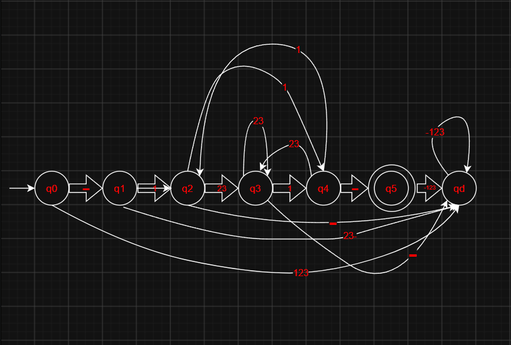

# Задача 1: Реализация конечного автомата для регулярного языка

## 1. Задание

Строка символов `1, 2, 3, -`, начинающаяся с префикса `-` и заканчивающаяся суффиксом `-`, между которыми располагается последовательность символов `2, 3` (длина может быть и нулевой) с префиксом и суффиксом `1` (суффикс предыдущей последовательности не является префиксом текущей).

**Пример:** `-111211223321-`

## 2. Регулярное выражение, задающее язык
-1(2+3)*1(1(2+3)1)-,где:
- `+` обозначает операцию ИЛИ (альтернативу);
- `*` обозначает ноль или более повторений.

## 3. Алфавит
{1, 2, 3, -}

## 4. Требования к реализации

1. Построить диаграмму переходов и таблицу переходов конечного автомата (КА).
2. Реализовать распознающий КА в виде подпрограммы.
3. Реализовать программу поиска цепочек языка в последовательности символов.
4. Обеспечить проверку корректности входной строки:
   - символы вне алфавита `{1, 2, 3, -}` — ошибка;
   - символ `-`, за которым не следует `1` — ошибка;
   - символ `-`, перед которым не стоит `1` (кроме начала строки) — ошибка.
5. Если во входной строке обнаружена ошибка — вывести сообщение об ошибке и завершить работу.
6. Если ошибок нет — найти и вывести все валидные цепочки языка.

## 5. Формат вывода

- Найденная цепочка: `позиция: цепочка` (где `позиция` — индекс начала цепочки в исходной строке).
- Ошибка во входной строке: `Ошибка: <описание>`.
- Цепочки не найдены: `цепочек не найдено`.

# Решение

## Диаграмма переходов и таблица переходов КА

| Состояние | `-` | `1` | `2` | `3` |
|:---------:|:---:|:---:|:---:|:---:|
| → q0      | q1  | qd  | qd  | qd  |
| q1        | qd  | q2  | qd  | qd  |
| q2        | qd  | q4  | q3  | q3  |
| q3        | qd  | q4  | q3  | q3  |
| q4        | q5  | q2  | q3  | q3  |
| *q5       | qd  | qd  | qd  | qd  |
| qd        | qd  | qd  | qd  | qd  |

## РВ, задающее язык

`-1(2+3)*1(1(2+3)*1)*-`

(или `-y(y)*-`, где `y` – `1(2+3)*1`).

`-` – префиксы и суффиксы.

`1(2+3)*1` – задаёт пару `1x1`, где `x` – либо пустота, либо последовательность из двоек и троек.

## Краткое описание работы подпрограммы, реализующей КА, и программы поиска цепочек языка в последовательности символов

Подпрограмма, реализующая конечный автомат (КА), выполняет строгую проверку всей входной строки на принадлежность заданному языку. Она считывает строку посимвольно слева направо, последовательно меняя состояния автомата согласно таблице переходов. Если на любом шаге встречается символ вне алфавита или автомат переходит в тупиковое состояние, строка немедленно отвергается. Цепочка считается распознанной только в том случае, если после обработки последнего символа автомат оказывается в финальном состоянии.

Программа поиска цепочек сначала считывает входную последовательность и проверяет её на наличие символов, не принадлежащих алфавиту {1, 2, 3, -}. При обнаружении такого символа программа выводит сообщение об ошибке и завершает работу. Если алфавит корректен, программа передает строку в подпрограмму КА. Поскольку автомат настроен на строгую проверку всей строки целиком, при успешном распознавании программа выводит найденную цепочку в формате «0: <цепочка>». Если строка не прошла проверку автомата, программа выводит сообщение «цепочек не найдено».
